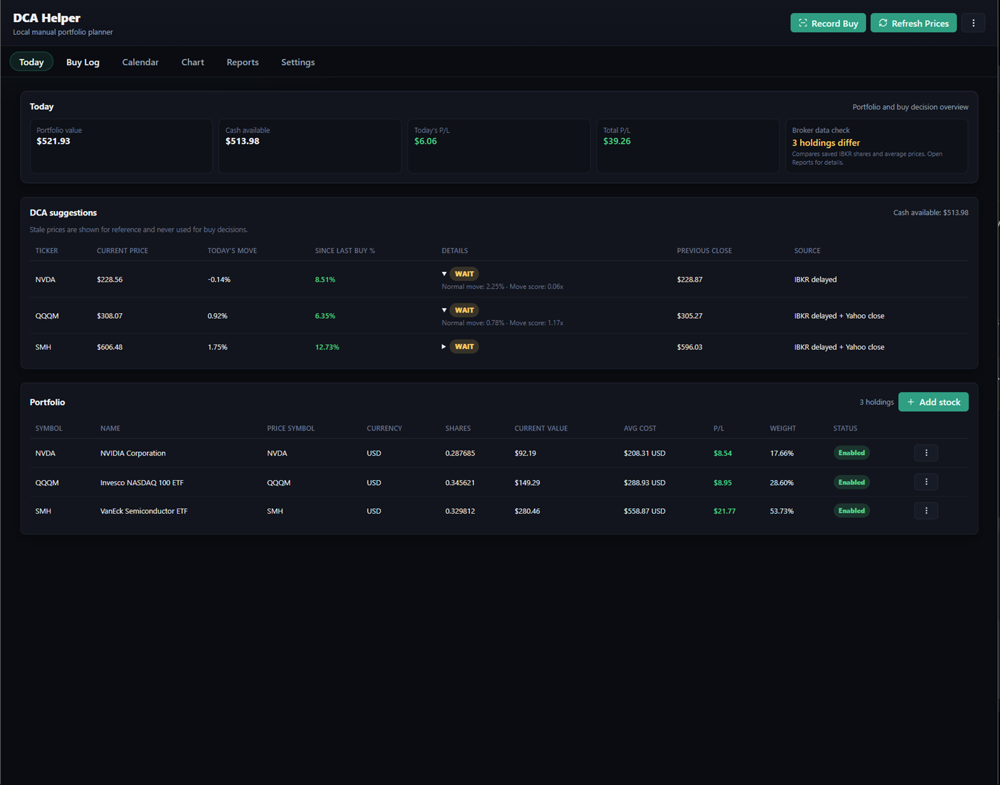
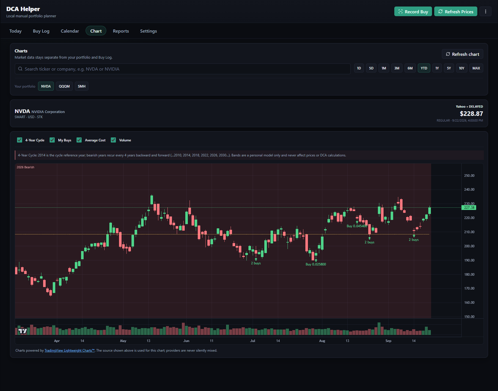
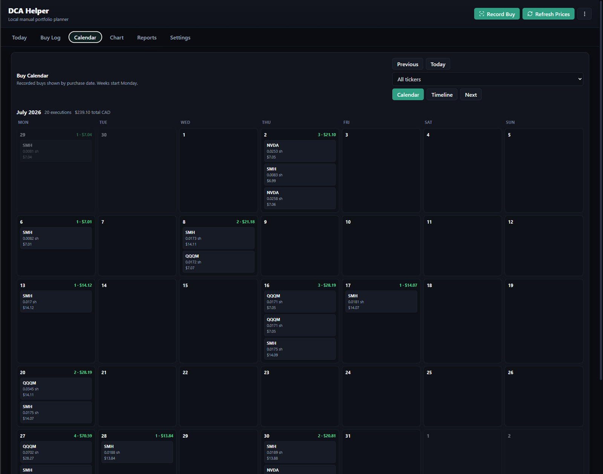
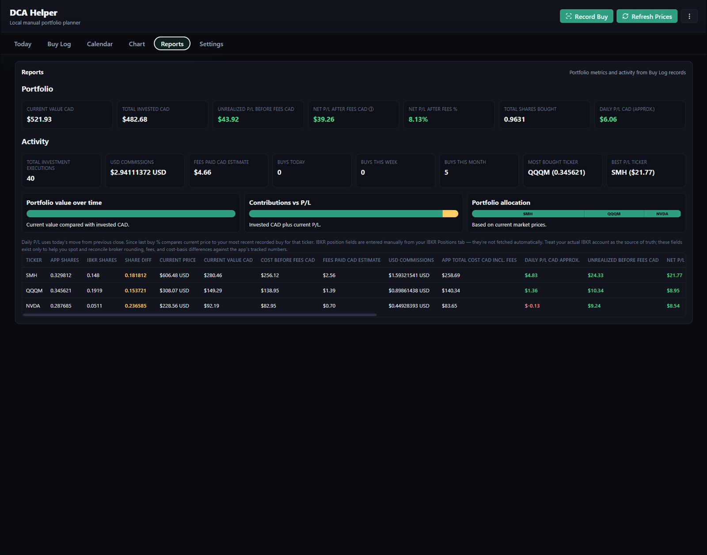

# DCA Helper

> A private, local-first desktop companion for Interactive Brokers users who want a clear record of recurring investments.

DCA Helper helps you track completed stock and ETF purchases, reconcile them against an **IBKR Activity Statement CSV**, monitor cash activity, and review your portfolio in one local Windows app. It is intentionally IBKR-focused: it does not place orders, connect to your account with brokerage credentials, or provide financial advice.

## Why DCA Helper

- **Record completed buys** from a Filled IBKR confirmation, a brokerage screenshot, or manual entry.
- **Reconcile safely** with IBKR Activity Statement CSV files. The app previews unchanged, corrected, missing, and unmatched records before applying changes.
- **Protect local history** with an automatic SQLite backup before reconciliation. Unmatched local trades are never deleted.
- **Track cash separately** through deposits, withdrawals, dividends, interest, fees, and buys.
- **Review your investing activity** through Today, Buy Log, Calendar, Reports, and Charts.
- **Keep data local.** Portfolio data, screenshots, statement CSVs, and backups remain on your computer.

## Screenshots

### Portfolio overview



See portfolio value, available cash, daily and total performance, DCA suggestions, and holding weights in one place.

### Interactive chart



The chart supports market-data source labels, candlesticks, volume, recorded-buy markers, average cost, and an optional personal 4-Year Cycle overlay. The cycle is a visualization only; it never changes prices, holdings, returns, or DCA calculations.

### Buy calendar



Browse recorded purchases by month with compact share quantities and daily CAD totals.

### Portfolio reports



Review portfolio performance, investment activity, fees, allocation, and IBKR reconciliation differences.

## Installation

Most users should download `DCA-Helper-Setup-1.0.61.exe` from the GitHub Releases page. The installer creates Desktop and Start Menu shortcuts and registers DCA Helper in Windows Installed Apps.

Installing a newer version keeps the existing local portfolio database. Uninstalling the application also leaves portfolio data in place unless the user removes it manually.

## Important privacy and safety notes

- Your database, statement CSVs, and backups remain on your computer.
- Do not commit Activity Statements, SQLite databases, logs, screenshots, `.env` files, or relay credentials. The included `.gitignore` blocks these.
- Reconciliation always shows a preview and creates a local SQLite backup before applying corrections.
- The app does not delete unmatched local trades during reconciliation.
- Market data is reference information; verify executions and account balances in IBKR.
- The app records an actual buy only from a completed execution. An IBKR **Transmit** screen is an order preview, not a filled trade.

## Recommended IBKR workflow

1. Add your holdings and record completed buys from **Filled** IBKR confirmations, screenshots, or manual entry.
2. Import a **Year-to-Date Activity Statement CSV** to establish or repair history.
3. Review the reconciliation preview. It identifies unchanged records, corrections, missing trades, and local records that need review.
4. Apply only the verified changes. The app creates a backup first and audits the saved result.
5. Import each completed calendar month thereafter for regular accuracy checks. New users do not see this reminder until their first successful statement import.
6. When the statement includes CAD ending cash, the app compares it with the ledger at that statement's period end and records only the dated difference, so overlapping monthly and YTD imports do not double-count cash.
7. Use **Add money** in the top bar to record a deposit. Other cash adjustments remain available through the local cash ledger and do not change shares or trade prices.

### Limit orders

Use **Reserve limit order** to save a buy or sell target, optionally attach the IBKR order-preview screenshot, and choose either shares or a cash amount. DCA Helper monitors the reference price automatically while the order is active and shows **Price reached** when the target is met. A price touch is not proof of an IBKR fill: verify that IBKR shows **Filled**, then record the actual execution. The app never submits or changes broker orders automatically.

## What this app is and is not

| DCA Helper does | DCA Helper does not do |
| --- | --- |
| Track a local buy log and cash ledger | Place, transmit, or manage IBKR orders |
| Reconcile IBKR Activity Statement CSV files | Connect to IBKR using your login credentials |
| Show reference market data and charts | Guarantee market-data accuracy or provide financial advice |
| Preserve a local backup before reconciliation | Claim support for other broker statement formats |

This beta is intentionally IBKR-focused.

## Development

Requirements: Node.js 20+ and Windows for the Electron installer.

```powershell
npm install
npm test
npm run build
npm run verify:electron-native
npm run dist
```

Production updates retain the established application ID and local data folder so an existing portfolio remains available after upgrading. The installer does not remove the local SQLite database.

## Market data

Yahoo is the default public-beta reference source. The existing local IBKR relay is optional developer infrastructure and must remain private; never expose an IBKR Gateway or relay directly to the public internet.

## License and third-party notices

This project is licensed under the MIT License. Charts use [TradingView Lightweight Charts](https://www.tradingview.com/lightweight-charts/), which retains its required attribution in the app.
